# OPC 插件新手上手指南

把公司的知识库、技能和业务工具放进 DeepSeek Harness（下文简称 **DSH**）。安装后，点右侧的 **OPC 知识库 / OPC 技能 / OPC MCP** 就能开始。

**第一次使用，建议先完成“安装 → 找到入口 → 登录 → 用知识库问一个问题”。** 技能和 MCP 可以之后再看。本文图片取自本机 DSH Desktop `0.2.2-rc.1`、OPC 插件 `0.1.4`，摄于 2026-11-06。全部配图保留完整的 DSH 客户端窗口，可点击图片查看大图。截图中的账号、公司空间、资源名称用于演示，你的列表以公司授权为准。

## 先知道这三个功能是做什么的

| 功能 | 用一句话理解 | 可以先试什么 |
| --- | --- | --- |
| **OPC 知识库** | 让 AI 查公司文档，再根据文档回答 | 报销材料、制度、流程、操作手册 |
| **OPC 技能** | 给 AI 装一份特定任务的操作说明 | 比较两张 Excel 表有哪些差异 |
| **OPC MCP** | 让 AI 通过公司提供的工具查询业务系统 | 根据商品内部 ID 查询价格，取决于公司开放的服务 |

知识库回答来自文档，实时商品价格来自业务系统。MCP 能否查询成功还取决于服务权限、参数和平台配置。

## 一、安装插件

### 第 1 步：打开「插件」页

打开 DSH，在窗口左侧点 **插件**。右上角可以看到黑色的 **添加插件** 按钮。

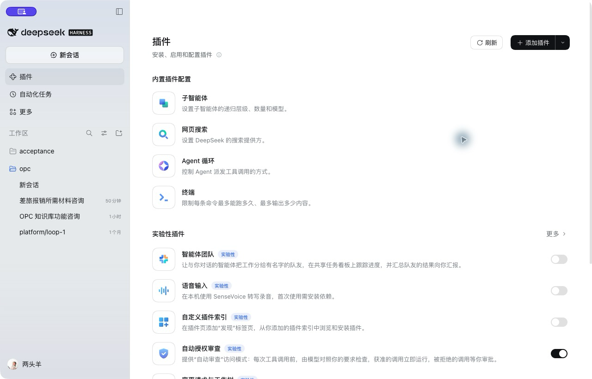

**已经装过？** 向下滚动，找 **已安装插件**。如果已有 `@opc/dsh-plugin-opc`，先看第 4 步核对版本和启用状态，避免反复安装同一版本。

### 第 2 步：选择「安装第三方插件」

点 **添加插件右边的小向下箭头**，在菜单中点 **安装第三方插件**。有些版本直接点击“添加插件”也会打开同一个窗口。

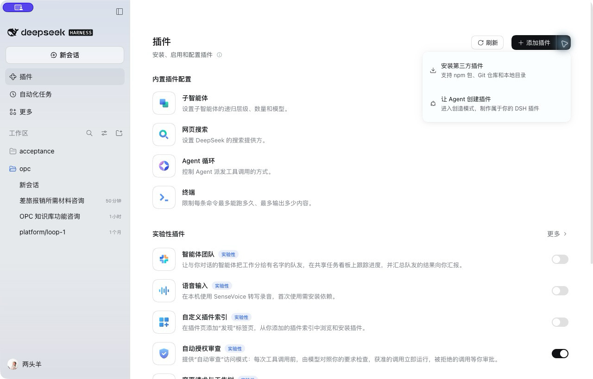

### 第 3 步：输入包名，点「安装」

在弹出窗口的 **包名或地址** 输入框里直接输入 npm 包名（推荐），然后点底部黑色的 **安装**：

```text
dsh-plugin-opc
```

> 也可以通过 Git 地址安装：`https://github.com/shtokendance/dsh-plugin-opc.git#release`。但通过 npm 包名安装可在后续享受 DSH 内置的一键自动检测和在线更新功能。

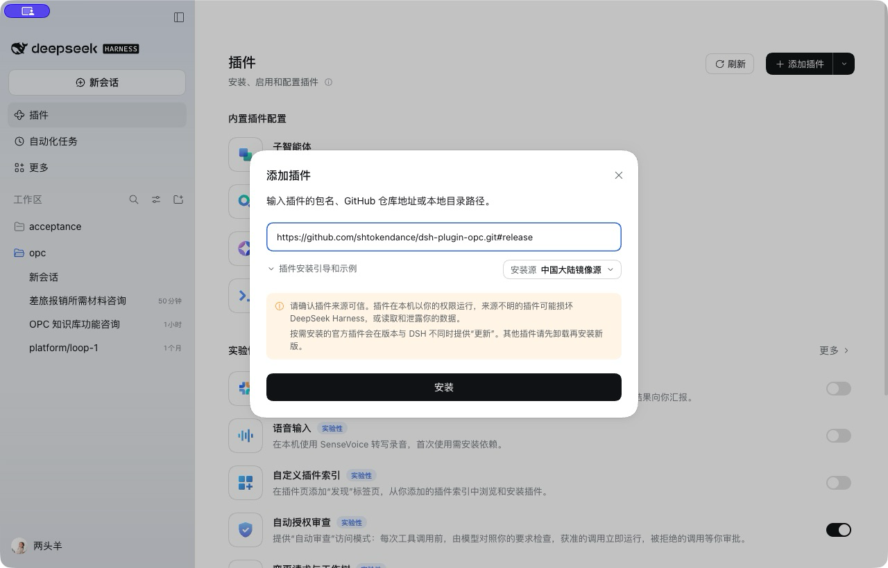

等待安装任务结束。网络慢时会花更长时间，可以展开 **查看安装详情** 查看进度。

### 第 4 步：确认装好了，再完整重启

回到 **插件 → 已安装插件**，找到并点击 `dsh-plugin-opc`。详细页应显示版本号，右上角的启用开关应处于打开状态。

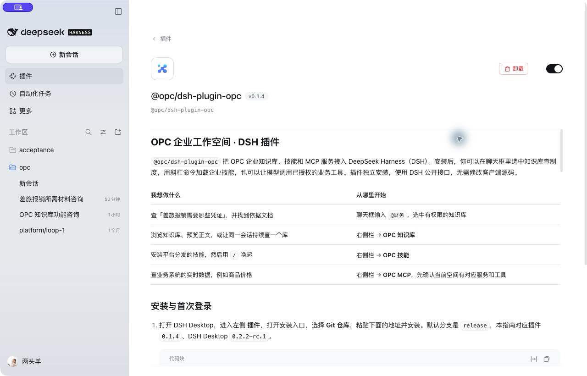

安装或更新后，**完整退出 DSH，再重新打开**。Mac 上可在屏幕最上方的 **DeepSeek Harness → 退出 DeepSeek Harness** 操作，或按 `⌘ Q`。只点窗口左上角红色圆点可能仅关闭窗口。

### 插件后续如何在线更新？

通过包名 `dsh-plugin-opc` 安装后，当有新版本发布时：
1. 打开 DSH 左侧 **插件** 页面。
2. 点击右上角的 **刷新** 按钮。
3. 如果有新版本，插件卡片及详情页右上角将直接亮起蓝色的 **【更新到 vX.X.X】** 按钮。
4. 点击更新按钮即可由客户端自动完成静默替换升级，**无需每次卸载重装**。

> 本次截图时，本机已经装有同版本。重复安装任务显示“无法从依赖变更中确定安装了哪一个包”，随后在详细页核对到插件 `0.1.4` 已启用。首次安装成功请以任务结果、已安装列表和实际功能入口一起判断。遇到相同提示先核对版本，暂时无需反复重试。

## 二、装完以后，到哪里找？

### 第 5 步：进入聊天页，打开右侧栏

点左侧 **新会话**，再点 **窗口右上角靠边的小侧栏图标**。这是“打开右侧边栏”，鼠标停在上面会显示名称。图中鼠标所在处就是这个按钮。

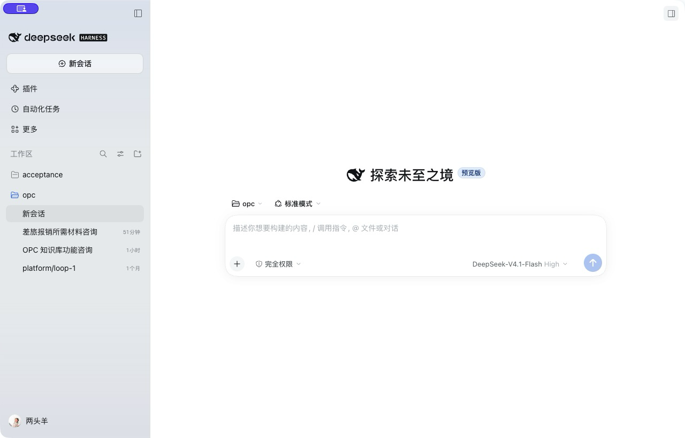

### 第 6 步：认准三个 OPC 入口

右侧出现 **开始** 页面后，选择你要使用的功能。建议第一次先点 **OPC 知识库**。

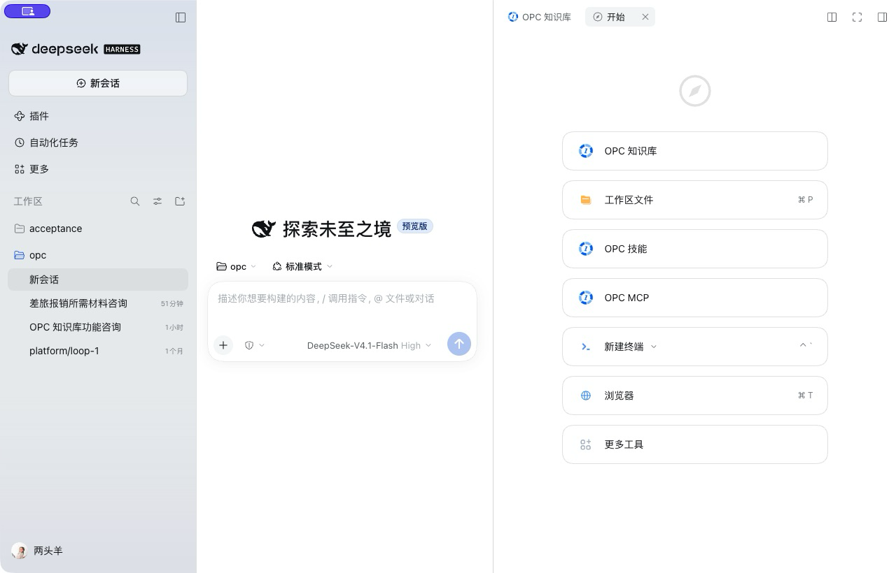

已经打开一个功能时，可以点右侧面板顶部的 **＋（新标签页）** 回到入口页，再打开另一个功能。三个功能可各占一个标签页，直接点击标签切换。

## 三、登录公司账号和选择空间

### 第 7 步：完成企业登录

第一次打开 OPC 面板，会看到 **连接 OPC 工作空间** 和 **企业微信 / SSO 登录** 按钮。

1. 点击 **企业微信 / SSO 登录**。
2. 默认浏览器会打开公司的登录页面。按页面提示扫码或完成公司登录。
3. 登录完成后，回到 DSH。面板显示账号和公司空间，表示登录成功。
4. 如果浏览器被关掉，可点面板中的 **重新打开授权页**。

如果你已经登录，面板会直接显示资源列表，可继续下一步。DSH 自己的模型账号和 OPC 企业账号各自登录；聊天生成回答还需要 DSH 中有可用模型。

### 第 8 步：选择有资源的企业空间

面板上方的下拉框用于选择企业空间，例如 **本来生活**、**技术交付中心**。切换后，知识库、技能和 MCP 列表随之更新。没有资源时先确认选对了空间，再联系公司管理员核对授权。

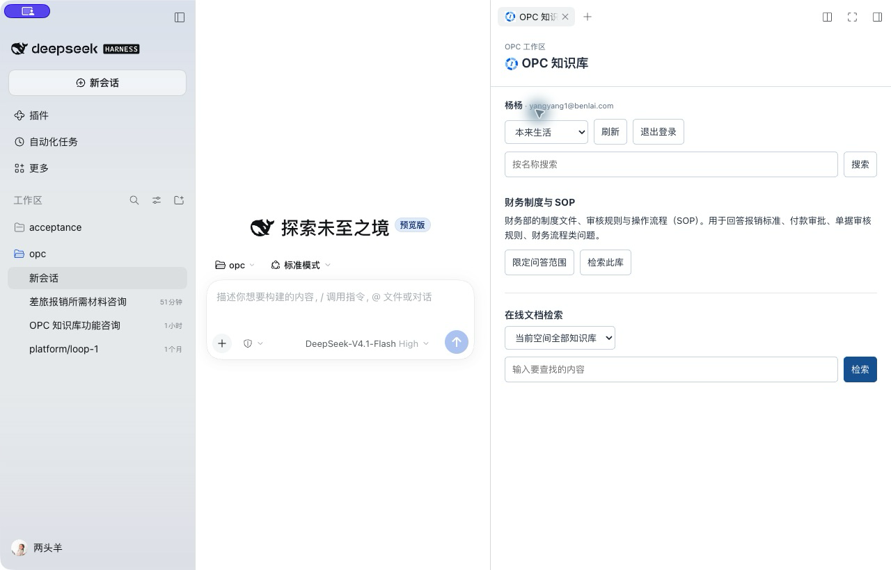

## 四、先试一个最简单的知识库问题

### 第 9 步：在聊天框输入 @ 和库名

点击**聊天输入框**，先输入 `@`，再输入你知道的库名，例如 `财务`。出现菜单后，点击 **OPC 知识库** 分组里的 **财务制度与SOP**。如果你的公司使用其他名称，就输入那个名称。


### 第 10 步：选中后，继续写问题，点蓝色发送箭头

选中库后，输入框会出现库名引用。**保留这段引用，在后面写问题**。可以复制这句作为第一次练习：

> 请告诉我差旅报销需要准备哪些材料，并列出依据文档的名称。

然后点输入框**右下角的蓝色向上箭头**。


### 第 11 步：看回答，也看依据文档

等待 AI 回答。它会先检索文档，再读取相关内容。建议第一次要求它列出来源文档，方便自己核对。

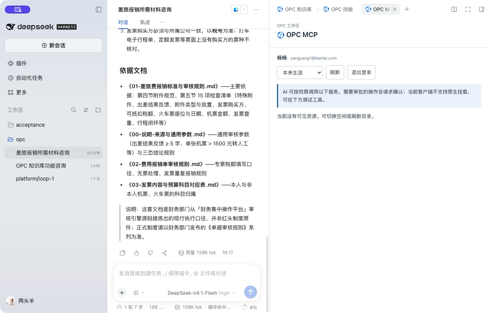

图中回答来自本次本机实测。你也可以展开对话里的 **已调用工具**，查看 `opc_knowledge_search`（检索）和 `opc_knowledge_read`（读取）的结果。

**下一条还要查同一个库？** 再选一次 `@库名`。一次提问选择一个库。希望本会话持续固定在某个库时，在右侧点击该库的 **限定问答范围**；取消时点 **取消限定**。引用是本轮选择，面板固定是本会话的持续选择。

## 五、自己查文档，不让 AI 总结

### 第 12 步：选库，填关键词，点击「检索」

在右侧 **OPC 知识库** 面板中，找到目标库，点 **检索此库**。下方的“检索知识库”会切换到该库。在 **输入要查找的内容** 框里填 `差旅` 等关键词，点旁边蓝色 **检索**。

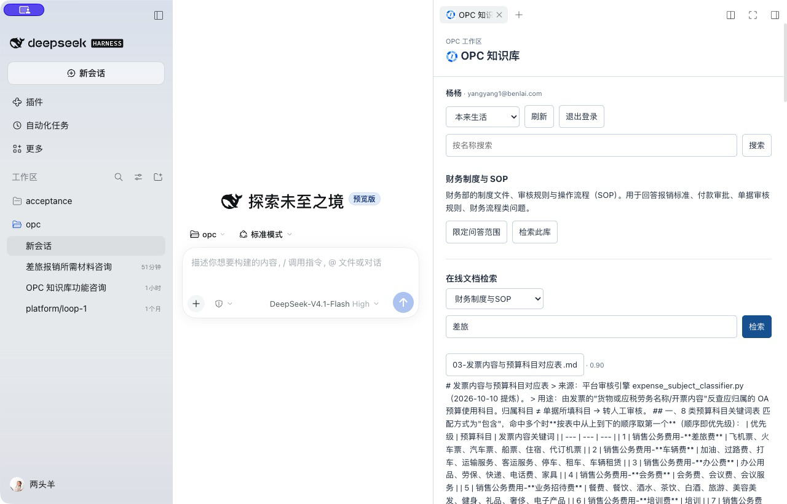

注意区分两个输入框：上面的 **按名称搜索** 用于找“库”，下面的 **输入要查找的内容** 用于查“库里的文档”。

### 第 13 步：点击结果中的文档名，打开正文

检索结果会显示文档名称和命中片段。点击**文档名按钮**，正文显示在面板下方；需要时在右侧面板内向下滚动。阅读结束，点击 **关闭正文**。


## 六、安装并使用一项技能

技能适合完成具体任务。第一次建议选 **excel-compare** 这样的表格比对技能。

### 第 14 步：打开 OPC 技能，点击「下载安装」

点面板顶部 **＋ → OPC 技能**。在当前空间的列表里找到技能，先阅读用途说明，再点该技能下面的 **下载安装**。下图用尚未安装的 PPT 技能展示按钮位置；后两张图用已经安装的 excel-compare 展示启用和调用效果。

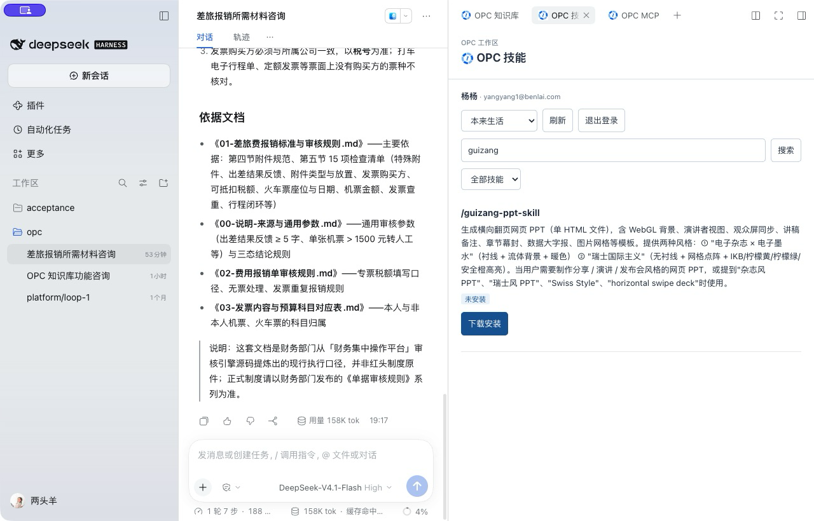

### 第 15 步：确认显示「已启用」

安装完成后，技能下方应显示 **已启用 · 输入 / 调用**，操作按钮变为 **停用** 和 **卸载**。只安装一次即可，之后可反复使用。停用后能重新启用，卸载后需要重新下载。

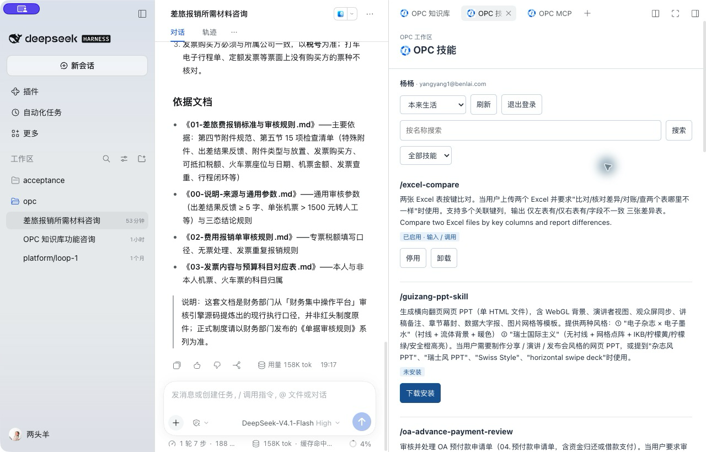

### 第 16 步：回到聊天框，输入 / 和技能名

输入 `/excel-compare`，在弹出的 **技能** 候选中选择 `excel-compare`。该菜单显示 `[OPC]`，帮助你识别公司技能。

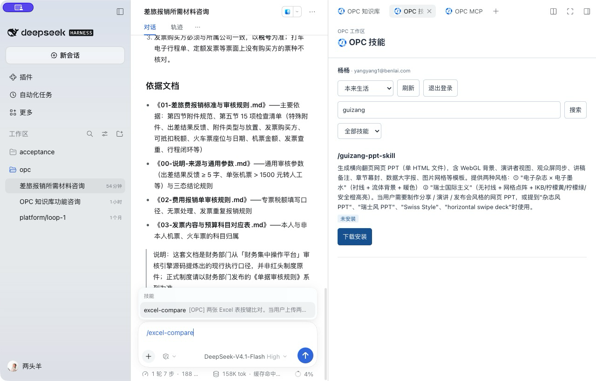

选择后，描述你的任务，例如：

> 请按商品编码比对这两张 Excel，列出只在第一张表、只在第二张表和字段不同的记录。缺少文件时请先问我。

需要处理文件时，点击聊天输入框左下角 **＋** 按 DSH 提示添加文件，并告诉 AI 比较哪一列。图中只演示技能安装和唤起，文件处理结果取决于实际文件与所选技能。

## 七、MCP：查看公司业务系统提供了哪些工具

MCP 是公司开放给 AI 的业务工具入口，例如查商品价格。下面的步骤适合在管理员已提供服务 ID 和查询参数后使用。

### 第 17 步：打开 OPC MCP，选对空间

点右侧顶部 **＋ → OPC MCP**。有些空间没有 MCP 服务，可以先切换到公司管理员指定的空间。本机示例在 **技术交付中心**，可见 **搜索服务** 和 **erp 商品价格服务**。

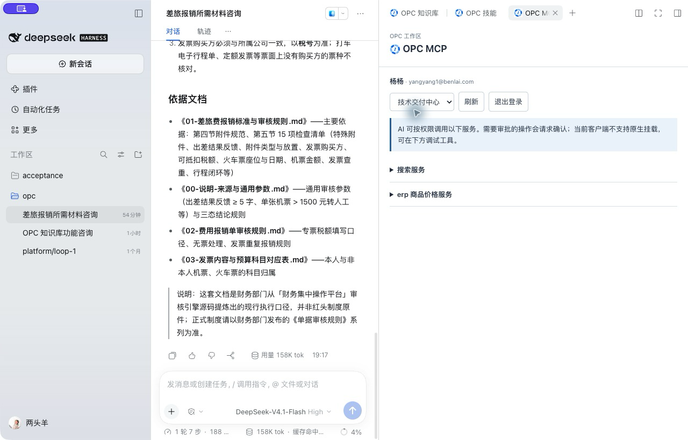

### 第 18 步：展开服务，阅读工具说明

点击服务名前面的 **小三角**。下方会显示工具名、用途和参数。例如 `post_ProductPrice_Get` 的参数是 `productSysNo`，要求商品内部的整数 ID。

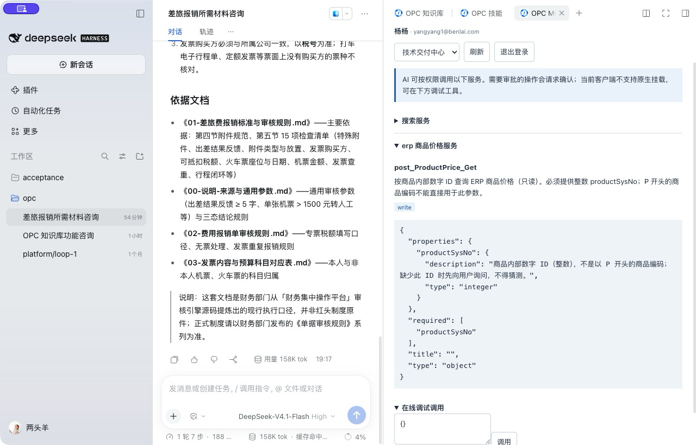

### 第 19 步：第一次使用，请先向管理员要这三项

| 需要的信息 | 如何理解 |
| --- | --- |
| 服务 ID（service_id） | 平台里登记的准确服务标识，请管理员复制完整值 |
| 工具名（tool_name） | 上图的 `post_ProductPrice_Get` 就是工具名 |
| 必填参数 | 比如商品内部 ID，以工具说明为准 |

当前插件的聊天工具需要准确的服务 ID，面板没有显示这个字段，模型也没有服务目录查询工具。**请直接找管理员索要完整值**；只告诉 AI“商品中心”会使它缺少调用信息。

拿到信息后，在聊天框发送下面的话，把 `实际服务ID` 替换成管理员给你的值：

> 请使用 opc_mcp_invoke，service_id 为「实际服务ID」，tool_name 为 post_ProductPrice_Get，arguments 为 {"productSysNo":2427240}。查询商品价格，调用失败就显示实际错误，请不要猜测服务ID或工具名。

其中 `2427240` 只是示例，请换成管理员确认的商品内部 ID。

### 第 20 步：如何判断查询有没有成功

展开对话里的 **已调用工具**，找到 `opc_mcp_invoke`。检查返回的是实际业务数据还是错误。平台要求审批时，先阅读工具和参数，再决定是否允许。高敏操作的审批是否出现，由平台策略决定。

右侧 **在线调试调用** 适合管理员排查：在参数框填写 JSON，再点 **调用**。普通使用者优先按上一段在聊天框提问。

目前测试服缺少审批参数加密配置，需要审批的调用可能返回 `INTEGRATION_ARGS_KEY_REQUIRED`，需要平台管理员补齐配置。**本指南的 MCP 截图演示目录和参数查看，尚无真实业务成功结果截图。**

## 八、常见问题：先看这里

| 遇到的情况 | 先做什么 |
| --- | --- |
| 安装页说“无法从依赖变更中确定安装了哪一个包” | 先回“插件 → 已安装插件”查看是否已装同版本。已装好就完整重启后查看功能入口。 |
| 装完却看不到右边的 OPC | 点左侧“新会话”，点窗口右上角侧栏图标，再在“开始”页找 OPC。仍没有时核对插件启用开关，然后完整重启。 |
| 没有可用工作区 | 使用 DSH 左侧“工作区”旁的添加按钮，按客户端引导选一个本机文件夹。公司已有工作区时可直接选择。 |
| 输入 @ 后找不到知识库 | 确认 OPC 已登录、空间正确，再输入库名的一部分。更新后完整重启 DSH。 |
| 只看到文件和对话候选 | 确认 OPC 插件版本与后台已更新。0.1.4 对旧宿主会隐藏 OPC 候选，完整退出再打开。 |
| 点击登录提示 HTTP 404 | 更新 OPC 插件后完整重启 DSH，让后台注册新版登录路由。 |
| 浏览器没有打开或被关了 | 看 OPC 面板中的“重新打开授权页”，或取消后重新发起登录。 |
| 登录后是空列表 | 核对企业空间。仍为空时请管理员确认账号和资源授权。 |
| 聊天框提示选择模型 | 在输入框下方选择模型，并按 DSH 自身引导登录模型账号。 |
| AI 一直问 service_id | 请公司管理员提供准确服务 ID。当前聊天工具需要这个字段。 |
| MCP 返回 INTEGRATION_ARGS_KEY_REQUIRED | 把错误截图发给平台管理员处理；稍后再试，避免反复提交同一次操作。 |

## OPC 应用部署

从已打开的 DSH 对话进入右侧的 **OPC 应用**，选择 **部署新应用**，导入源码 ZIP 或填写本机源码目录。AI 在独立副本上分析和提出容器改造。核对文件改动后生成部署包，再填写运行配置、按字段选择 Platform 开放的资源，并确认发布。

可以单独选择改造模型。向导会保存部署配置草稿，并可在发布前预览完整应用技能。服务器启动后，向导自动发起首次业务验证，也可手动检查。应用版本、制品摘要、健康身份和只读业务验证都通过后，在对话框输入 `/app-<应用标识>` 选择技能。纯页面应用需要打开页面并确认。普通 HTTP/JSON 接口可作为技能调用，写操作会触发 DSH 审批。应用卡片可启用或停用本地技能，升级和回滚会保留该设置。

改造阶段会识别应用的登录方式和权限规则。受保护的接口在部署后填写应用账号、密码或现有会话，点击 **仅重试业务验证** 即可复测。默认仅用于本次验证。勾选保存后，通过验证的凭据由 DSH 凭据服务保管，可用于对话调用。

应用创建者可在 **管理与回退** 查看日志、版本和存储卷，下载历史制品、单卷备份或整应用备份。平台文件直接保存到运行 DSH 的电脑的下载目录。向导内导出的本地交付包仍有 64 MiB 单文件上限。配置变化后重新验证业务。回滚恢复应用版本和运行配置，保留卷中的业务数据。

需要支持 `/integration/v1/apps` 的 Platform。企微登录后即可部署，所有登录用户共享应用列表。部署资源由 Platform 的 `app_deploy.enterprise_deploy_resources` 配置提供。应用目录和部署任务独立于知识空间。DSH Desktop 使用自带 Python，独立 Web 运行需在 PATH 提供 Python 3.9 或更新版本。

## 给管理员和开发者

插件通过公开接口接入 DSH。企业认证使用独立凭据命名空间，OPC 服务地址由 `platformBaseUrl` 配置。默认域名是 `https://shtokendance.benlai.com`。参见[配置示例](config/overlay.example.yml)、[一期验收记录](docs/acceptance-matrix.md)。

## 本地开发

需要 Node.js 24.9 或更高版本、npm，以及一个已安装依赖、生成了 Host/Client 类型和 Web 构建的 DSH 源码目录。以下示例假定两个仓库位于同一父目录：

```sh
npm ci
node scripts/link-dsh.mjs ../deepseek-harness
node scripts/configure-dsh.mjs ../deepseek-harness
npm test
npm run typecheck
npx tsc -p tsconfig.client.json
npm run build
```

链接和类型配置都生成在插件目录内。重新执行 `npm ci` 后需要重新链接。开发时可通过 DSH CLI 的 `web --patch` 加载外部 YAML，把插件入口指向构建后的 `lib/index.js`。OPC 服务域名由 `platformBaseUrl` 配置，默认是 `https://shtokendance.benlai.com`。参见[配置示例](config/overlay.example.yml)和[一期验收记录](docs/acceptance-matrix.md)。
