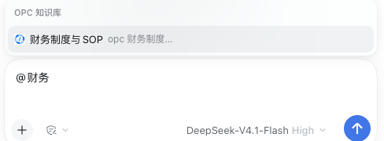
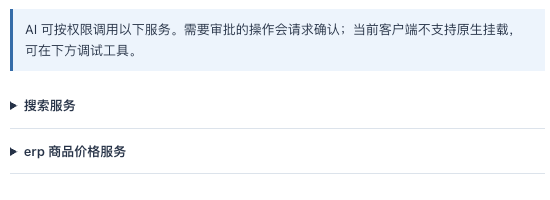

# OPC 企业工作空间 · DSH 插件

`@opc/dsh-plugin-opc` 把 OPC 企业知识库、技能和 MCP 服务接入 DeepSeek Harness（DSH）。安装后，你可以在聊天框里选中知识库查制度，用斜杠命令加载企业技能，也可以让模型调用已授权的业务工具。插件独立安装，使用 DSH 公开接口，无需修改客户端源码。

| 我想做什么 | 从哪里开始 |
| --- | --- |
| 查「差旅报销需要哪些凭证」，并找到依据文档 | 聊天框输入 `@财务`，选中有权限的知识库 |
| 浏览知识库、预览正文，或让同一会话持续查一个库 | 右侧栏 → **OPC 知识库** |
| 安装平台分发的技能，然后用 `/` 唤起 | 右侧栏 → **OPC 技能** |
| 查业务系统的实时数据，例如商品价格 | 右侧栏 → **OPC MCP**，先确认当前空间有对应服务和工具 |

## 安装与首次登录

1. 打开 DSH Desktop，进入左侧 **插件**，打开安装入口，选择 **Git 仓库**，粘贴下面的地址并安装。默认分支是 `release`，本指南对应插件 `0.1.4`、DSH Desktop `0.2.2-rc.1`。

   ```text
   https://github.com/shtokendance/dsh-plugin-opc.git
   ```

   

2. 安装完成后，完全退出并重新打开 DSH Desktop，让插件界面和后台加载同一版本。后续通过 Git 更新插件时也执行这一步。
3. 打开右侧栏，在「开始」页选择 **OPC 知识库**，点击 **企业微信 / SSO 登录**。在浏览器完成企业授权后，回到 DSH，选择你要使用的企业空间。企业登录和 DSH 个人账号各自独立。
4. 确认面板显示当前账号、空间和资源列表。三个面板共用所选空间；各空间的可见知识库、已启用技能和 MCP 服务可能不同。

## 在聊天里查知识库

在聊天框输入 `@`，再输入库名的一部分。比如输入 `@财务`，点击 **OPC 知识库** 分组里的「财务制度与 SOP」，然后在引用后面继续写问题并发送。



> 差旅报销需要哪些凭证？请只查我选的知识库，并列出依据文档的名称。

模型通过 `opc_knowledge_search` 检索片段，再用 `opc_knowledge_read` 读取命中文档。展开对话里的 **已调用工具** 可以检查调用和结果。一次提问选一个库，引用用于本轮；要让后续提问持续限定在同一库，点击面板中的 **限定问答范围**。只想自己查文档时，可以直接使用面板的 **检索此库** 并打开命中结果。

**升级提示：** 曾出现过界面已经升级、后台仍运行旧版的情况。这时聊天框能选中知识库，但后台可能按整个空间检索。0.1.4 已加入宿主能力检查，旧宿主不再提供新版候选。更新后请完整重启桌面端，并在工具结果中核对 `knowledge_base_id` 是否为所选库，再使用答案。

## 安装和使用企业技能

在 **OPC 技能** 面板选择技能，点击 **下载安装**。启用后，在聊天框输入 `/` 和技能名，从 DSH 原生命令候选中选择。例如，当前空间分发了 `excel-compare` 时，可输入 `/excel-compare`。也可以让 Agent 按名称加载技能说明。

面板支持更新、停用、重新启用和卸载。插件在激活新版本前校验下载包的 SHA-256 并检查 ZIP 内容。切换空间后，聊天框只展示新空间已启用的企业技能。

## 在聊天里调用 MCP

打开 **OPC MCP**，展开一个服务，查看工具名、用途和参数。面板只展示当前账号在所选空间可见的服务。不同企业空间的工具和参数会不同。



聊天调用使用 `opc_mcp_invoke`。当前版本的 `@` 候选用于知识库；使用 MCP 时，直接在聊天框描述要执行的查询即可。给模型准确的服务 ID、工具名和业务参数，具体值以平台配置为准。例如：

> 请用 opc_mcp_invoke 调用搜索服务（服务 ID：填入实际值），工具名 post_LifeProduct_Search，搜索「苹果」，只取第一页一条。缺少必填参数时先问我。如果调用失败，请显示实际错误。

也可以在面板里按工具的参数说明填写 JSON，点击 **在线调试调用**。平台决定是否需要审批。聊天调用使用 DSH 审批，面板调试的审批在 OPC 面板中处理。出现 **已调用工具** 表示发起了请求，业务是否成功要看工具返回值。

在 DSH Desktop `0.2.2-rc.1` 上可以使用聊天调用和面板调试。原生「挂载到 DSH」入口仅在宿主提供 `mcpManager` 时显示。当前测试服已验证服务目录和工具参数，真实审批及业务成功返回仍待验收。

## 常见问题

| 现象 | 如何处理 |
| --- | --- |
| 安装提示与 DSH 版本不兼容 | 检查安装来源是否为上面的 Git 地址，确认版本至少是 `0.1.3`。旧版 `0.1.0` 的依赖声明会被 DSH Desktop `0.2.2-rc.1` 拒绝。 |
| 点击登录出现 `/api/opc/startLogin: HTTP 404` | 确认插件已更新，然后完整退出并重新打开 DSH。早期版本会因宿主缺少 MCP 挂载服务而无法注册登录路由。 |
| 登录了却看不到知识库、技能或服务 | 先检查面板中所选的企业空间，再核对账号在 OPC 平台的资源授权。 |
| MCP 返回 `INTEGRATION_ARGS_KEY_REQUIRED` | 测试服知识服务缺少保存待审批参数所需的加密密钥，业务调用未执行。此项由平台管理员处理。 |

## 本地开发

需要 Node.js 24.9 或更高版本、npm，以及一个已安装依赖、生成了 Host/Client 类型和 Web 构建的 DSH 源码目录。以下示例假定两个仓库位于同一父目录：

```sh
npm ci
node scripts/link-dsh.mjs ../deepseek-harness
node scripts/configure-dsh.mjs ../deepseek-harness
npm test
npm run typecheck
npx tsc -p tsconfig.client.json
npm run build
```

链接和类型配置都生成在插件目录内。重新执行 `npm ci` 后需要重新链接。开发时可通过 DSH CLI 的 `web --patch` 加载外部 YAML，把插件入口指向构建后的 `lib/index.js`。OPC 服务域名由 `platformBaseUrl` 配置，默认是 `https://shtokendance.benlai.com`。参见[配置示例](config/overlay.example.yml)和[一期验收记录](docs/acceptance-matrix.md)。
